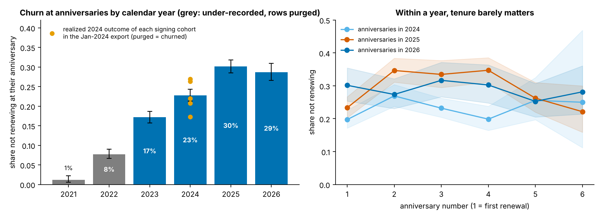
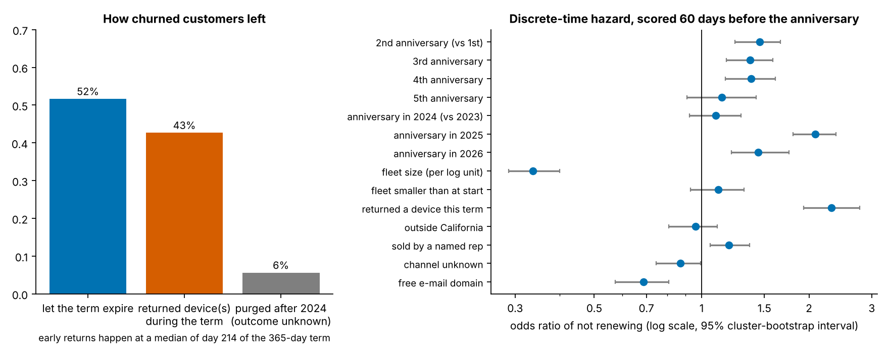

# eld-subscription-lifecycle

**Seven years of one-year ELD subscriptions: who leaves, when, and what next year's renewal desk is up against.**

[](https://github.com/JacobCCMorgan/eld-subscription-lifecycle/actions/workflows/ci.yml)

An ELD vendor sells one-year subscriptions per vehicle, mostly to one- and two-truck operators, and renews
them a year at a time. Its CRM contract list (13,753 vehicle-subscription rows, about 4,800 customer
organizations, 2019-2026) is the only record of who stayed and who left. This repository turns that list
into customer lifecycles, measures the renewal hazard, tests whether the renewal desk can rank accounts
60 days before expiry, lays out the next twelve months of renewals and new signings, and reads the ELD 2.0
migration call campaign against what customers did afterwards. A second export of the same list from
January 2024 is used to validate the reconstruction. Inputs are de-identified and join to the
[`telematics-data-foundation`](https://github.com/JacobCCMorgan/telematics-data-foundation) tables.

## Findings

- **The CRM overwrites term dates at renewal and purges old rows, and both facts change the answers.**
  93 % of `activation_date - contract_date` gaps are whole multiples of 365 days; the same device shows
  `activation_date` moved forward by exactly a year between the 2024 and 2026 exports for 40 % of units.
  `activation_date` is the start of the current term, so "activations per month" and "returned within a
  year of activation" computed from it are artefacts. Of the 2,968 customers active in January 2024, 183
  have no row left today; the 2023 cohort has fewer rows now (763) than it had active customers then (851).
  Purged customers are churned customers, so churn before 2023 is under-recorded. The reconstruction is
  validated on the 2024 export (95.5 % of its customers reconstructed as covered on that date, 88.7 % with
  the same start date) and the purged ones are restored from it.
- **The first anniversary is not a cliff.** Among anniversaries reached in 2024-2026, 23 % of customers do
  not renew at the first, 30 % at the second, 28 % at the third, 29 % at the fourth. Kaplan-Meier across
  cohorts: 92 % still customers after one year, 78 % after two, 62 % after three, 49 % after four.
- **Calendar time dominates tenure.** The share of anniversaries ending in non-renewal rose from 17 % in
  2023 to 23 % in 2024 and 30 % in 2025 (29 % in 2026 to date), at every tenure; the 2024 export confirms
  the level independently (17-27 % by cohort, purged counted as churned). Odds ratio for a 2025 anniversary
  versus 2023: 2.1 (1.8-2.4).
- **Fleet size at renewal time is the strongest attribute.** Accounts running one vehicle 60 days before
  the anniversary fail to renew 25 % of the time; two vehicles 14 %, three to five 13 %, six or more 8 %.
  Fleet size at signing separates much less (22 % vs 15 % for one- vs two-vehicle starts).
- **43 % of churned customers return the device(s) mid-term**, at a median of day 215 of the 365-day term;
  52 % let the term expire. 31 % of first-year churn is already done before the 60-day decision point. A
  return during the current term multiplies the odds of non-renewal by 2.3 (2.0-2.8): it is the one
  early-warning signal the CRM already holds.
- **The renewal desk gets a modest ranking, not a forecast.** On a time-ordered holdout (2024 signings,
  638 customers, 19 % non-renewal) the best model reaches ROC-AUC 0.59 (0.54-0.65); calling the top 20 % of
  accounts reaches 30 % of the churners. The all-anniversary hazard model scored on 2026 anniversaries has
  AUC 0.59 but predicts 28 % against 22 % observed, because the yearly level moves more than any customer
  attribute. Attributes at signing alone: Cox concordance 0.55.
- **Next 60 days and next 12 months.** 408 customers with 1,075 subscriptions reach an anniversary by
  27 Nov 2026 (`reports/renewal_risk_list.csv`, ranked, about 150 expected non-renewals). 3,663 subscriptions
  from 2,928 customers come up in the twelve months after the export: 642 expected non-renewals at the
  recent-year rate, 843 at the 2025 peak rate, with a July peak of 395 expiring terms. New signings run at
  33 per month; the backtested methods put the next twelve months between about 400 and 560.
- **The hardware migration is nearly done and the calls were predictive.** 90 % of active subscriptions are
  on the 2.0 unit; 365 legacy units at 251 customers remain. Five call rounds: round 2 (1,184 calls) reached
  a person on 7 % of calls, and repeated attempts did not raise reach (28 %, 29 %, 23 %). Of customers who
  agreed to exchange in 2025, 88 % are on the new unit and 4 % have left; of those who said cancel / closed /
  on hold, 73 % have left; 43 % of customers listed but never called are gone, so the lists carried accounts
  already on their way out. 152 of the 999 September-2026 calls went to customers who had already swapped.

Full write-up with figures: [`reports/subscription_lifecycle_report.md`](reports/subscription_lifecycle_report.md).




## Method

1. **Semantics first** (`data.py`): placeholder dates removed, the renewal count of each slot recovered from the
   rolled-forward term start, end of paid coverage per row (term end or earlier return).
2. **Organizations and anniversaries** (`orgs.py`): one row per customer (start = first contract date, end of
   coverage, churned after a 30-day grace, exit mode) and one row per customer x anniversary reached, with the
   outcome (renewed = coverage runs 180 days past the anniversary) and covariates measured 60 days before it.
   Customers purged after the January 2024 export are rebuilt from that export.
3. **Validation** (`validate.py`): device-level proof of the roll-forward, purge counts by cohort, realized
   next-anniversary outcomes of the 2024 customers.
4. **Survival** (`survival.py`): Kaplan-Meier by cohort and segment; Cox on signing attributes (cohorts 2023+);
   discrete-time logistic hazard with tenure and calendar-year dummies, cluster-bootstrap intervals.
5. **Renewal models** (`renewal_model.py`): first-anniversary prediction trained on 2021-2023 signings and
   scored on 2024 signings; hazard model fitted on 2023-2025 and scored on 2026; calibration, lift at the top
   decile and quintile; the 60-day risk list.
6. **Demand, hardware, calls** (`demand.py`, `lineage.py`, `calls.py`): renewal calendar with expected
   non-renewals under two rate scenarios, backtested signings forecast with a parsimony rule, generation mix
   and resolvable transitions, call funnel and outcomes by what the customer said.

## Repository layout

```
data/input/             de-identified inputs (contracts, 2024 export, call rounds) and SOURCE.md
scripts/prepare_inputs.py   how the inputs were produced (needs the raw workbooks and the key; not runnable publicly)
src/sublife/            data, orgs, validate, survival, renewal_model, demand, lineage, calls, report, run, cli
reports/                generated: report, 7 figures, renewal_risk_list.csv, 27 tables, summary.json
tests/                  toy contract rows through the whole chain, hazard fit, forecast, input invariants
```

## Reproduce

```bash
git clone https://github.com/JacobCCMorgan/eld-subscription-lifecycle.git
cd eld-subscription-lifecycle
python -m venv .venv && source .venv/bin/activate
pip install -e ".[dev]"
pytest -q                     # about 3 s
sublife --out reports         # tables, figures, risk list, report; about 25 s
```

## Limitations

- One vendor, one CRM; customers concentrated in California and in one- and two-vehicle fleets.
- Renewal histories are reconstructed from overwritten rows; validated only for customers alive in January
  2024. Anniversaries before 2023 are under-recorded (purged rows).
- The replacement link resolves to a known earlier generation for 22 % of replacement rows; whether swapping
  hardware changes renewal cannot be identified here.
- Call rounds 1-3 carry no per-call dates; outcomes are measured on the export date.
- Observational throughout; churn is derived from contract rows, not billing.

## License

MIT for the code; the data files are released under the terms in `LICENSE` (no re-identification).
