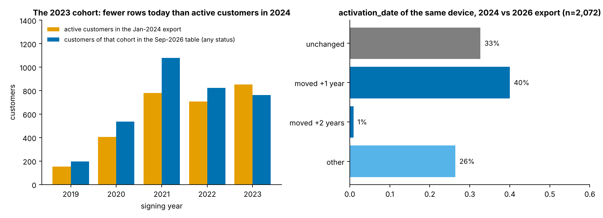
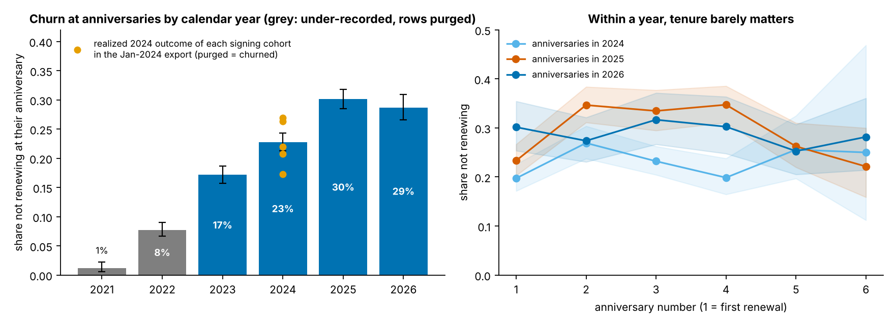
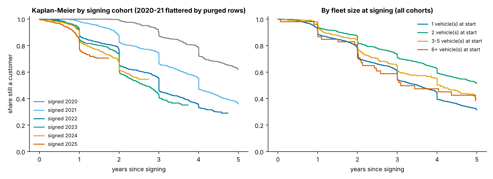
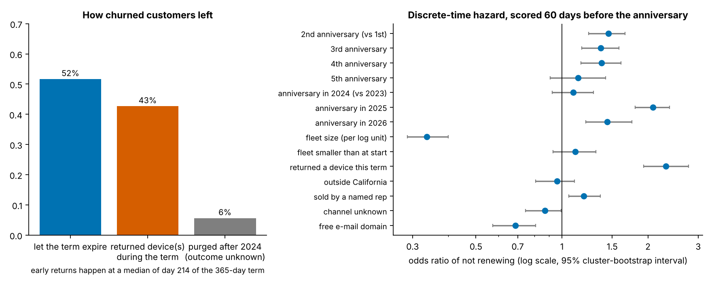
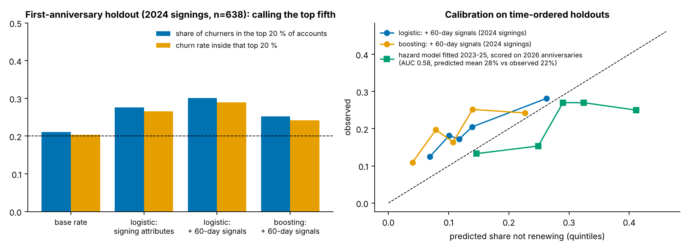
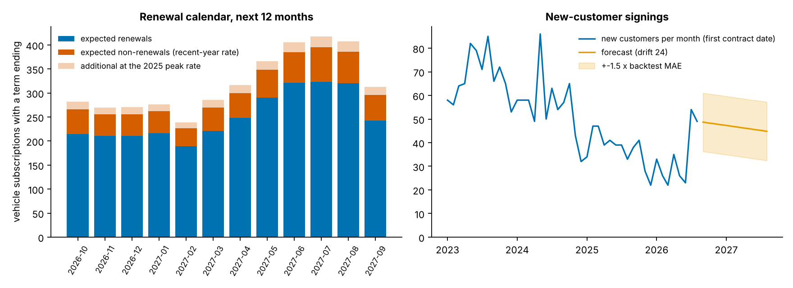
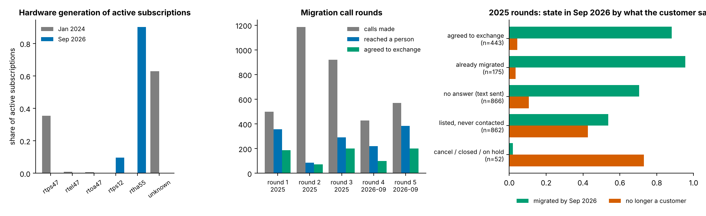

# Seven years of one-year ELD subscriptions: churn, the renewal calendar and the migration campaign

Data: the vendor's CRM contract list as of 2026-09-28 (13,753 vehicle-subscription rows, 4,836 customer organizations with usable dates), an export of the same list from 5 January 2024 (4,977 active rows), and the ELD 2.0 migration call log (9,509 list entries, 3,602 calls). All identifiers are keyed pseudonyms; see `data/input/SOURCE.md`.

## 1. What the dates mean, and what the table forgets

- The CRM keeps one row per vehicle slot and **overwrites the term dates at every renewal**: 93 % of the gaps between `contract_date` and `activation_date` are whole multiples of 365 days, and for the 2,072 units present in both exports, `activation_date` is unchanged for 33 %, moved forward by exactly one year for 40 % and by other amounts for 26 % (device swaps re-date the row). `activation_date` is therefore the start of the *current* term, not when the device went live; `contract_date` is the original sale and survives a device swap. Anything computed from `activation_date` as if it were an activation - monthly activation counts, time-to-return - is wrong by construction.
- **The table purges old rows.** Of the 2,968 customers active on 5 Jan 2024, 183 (6.2 %) have no dated row left in the 2026 table; the 2023 signing cohort has 763 customers in today's table but had 851 *active* ones in January 2024. Purged customers are churned customers, so churn before 2023 is under-recorded; this analysis restores the purged 2024 customers from the older export and treats anniversaries before 2023 as descriptive only.
- Where both exports can be compared the reconstruction holds: 95.5 % of the 2024 customers are reconstructed as covered on that date and 88.7 % get the same start date (within a month).

## 2. The lifecycle

- Across all cohorts, 91.9 % of customers are still there after one year, 78.2 % after two, 62.4 % after three and 49.0 % after four (Kaplan-Meier; early cohorts flattered by purging). Median tenure is 3.9 years.
- **The first anniversary is not a cliff.** Among anniversaries reached in 2024-2026 the share not renewing is 23 % at the first anniversary, 30 % at the second, 28 % at the third and 29 % at the fourth; the tenure odds ratios in the hazard model are 1.45 (1.24-1.66) for the second and 1.38 (1.16-1.61) for the fourth anniversary relative to the first.
- **Calendar time dominates.** The share of anniversaries ending in non-renewal rose from 17 % in 2023 to 23 % in 2024, 30 % in 2025 and 29 % in 2026 to date, at every tenure. The January-2024 export confirms the level independently: the customers active then churned at their next anniversary at 17 %-27 % depending on signing cohort, purged customers counted as churned. The hazard model's odds ratio for a 2025 anniversary versus 2023 is 2.08 (1.81-2.38).

## 3. Who leaves, and how

- **Fleet size is the strongest attribute.** Among accounts still active 60 days before an anniversary (2023-2026), those running one vehicle did not renew 25 % of the time, two vehicles 14 %, three to five 13 % and six or more 8 %; in the hazard model each log-unit of fleet size lowers the odds of not renewing by a factor of 0.34 (0.29-0.40). Fleet size *at signing* separates much less (22 % vs 15 % for one- vs two-vehicle starts): what matters is the fleet the customer still runs when the renewal comes up.
- **31 % of first-year churn happens before the 60-day decision point**: the customer has already returned the device(s) by the time a renewal desk would look at the account. Early intervention has to key off the return request, not the expiry date.
- 43 % of churned customers **returned their device(s) before the term ran out**, at a median of day 214 of the 365-day term (quartiles 112-299); 52 % simply let the term expire. A return during the current term, visible 60 days before the anniversary, multiplies the odds of non-renewal by 2.31 (1.94-2.78) - it is the one operational signal the CRM already holds.
- A free e-mail domain (owner-operators rather than companies with their own domain) goes with *lower* churn, odds ratio 0.69 (0.57-0.81); being outside California 0.96 (0.81-1.11) and the sales channel 1.19 (1.06-1.36) add little once fleet size and year are in the model. Cox on signing attributes alone (cohorts 2023+, n=2,231) has a concordance of 0.55: what a customer looks like on day one says very little about whether they will stay.

## 4. Can the renewal desk pick the right accounts 60 days out?

- First-anniversary holdout - trained on 2021-2023 signings, scored on the 638 customers who signed in 2024 (non-renewal rate 19 %): ROC-AUC 0.55 with signing attributes only, 0.59 (0.54-0.65) once the 60-day signals (device returned, fleet shrank, fleet size now) are added; gradient boosting 0.58. Calling the top 20 % of accounts reaches 30 % of the churners (random: 20 %) with a churn rate of 29 % inside the list.
- All-anniversary hazard model fitted on 2023-2025 and scored on the 1,501 anniversaries of 2026: ROC-AUC 0.58 (0.55-0.62), top 20 % reaches 22 % of churners. Scored at the 2025 level it predicts 28 % non-renewal against 22 % observed: the *level* moves from year to year by more than any customer attribute, so the model is a ranking tool, not a forecast of the rate.
- Verdict: the CRM alone yields a modest ranking (about 1.5x lift at the top), carried by two things - fleet size and a device return during the term. Usage data (the telemetry the foundation tables hold) is where a better signal would have to come from.

## 5. The next 60 days and the next 12 months

- **Risk list (`reports/renewal_risk_list.csv`)**: 408 customers with 1,075 subscriptions reach an anniversary between 2026-09-28 and 2026-11-27. Scored with the hazard model, 149 subscriptions are expected not to renew; the 87 tier-A accounts (top fifth by probability) carry 23 % of that expected loss, and 70 of them returned a device in the last twelve months.
- **Renewal calendar**: 3,663 subscriptions from 2,928 customers come up for renewal in the twelve months after the export; the model expects 640 non-renewals at the recent-year level and 842 at the 2025 peak level (17 %-23 %). The load is seasonal: 395 terms end in July 2027 against 227 in the quietest month, because signings cluster in spring and summer.
- **New customers**: 33 per month over the last twelve months. A rolling-origin backtest over 12 origins puts the four candidate methods within a few customers of each other (MAE 8.3-15.6 per month); the parsimony rule picks *drift 24*: about 561 new customers in the next twelve months (412-709 with the backtest band), against 397 if the last twelve months simply repeat. The series is short, the last two months are a jump, and the pre-2023 years are thinned by purging, so this is a planning range, not a prediction.
- **Hardware**: 90 % of active subscriptions already run the 2.0 unit; 366 legacy units at 252 customers remain to be swapped. Device returns run at 95 per month in 2026, of which 61 % were exits and the rest swaps or downsizing (the last two months cannot yet tell the two apart).

## 6. The migration call campaign

- Five rounds: 498, 1,184, 921, 428 and 571 calls. Round 1 reached a person on 72 % of calls; round 2, the largest, on 7 % - 93 % of its 1,184 calls ended in a text message. Across the 2025 rounds the reach rate did not improve with repeated attempts (28 %, 29 %, 23 % on the first, second and third attempt).
- What customers said in 2025 predicts where they are in September 2026: of those who **agreed to exchange**, 88 % are on the new unit and 4 % have left; of those who **did not answer** (text sent), 70 % migrated and 11 % left; of those who said **cancel / closed / on hold**, 73 % have left. Customers listed but never called were the worst group (43 % gone), which says the lists included accounts that were already on their way out.
- List hygiene: 152 of the 999 September-2026 calls went to customers who had already swapped the device.

## 7. Limitations

- One vendor, one CRM, customers concentrated in California and in one- and two-vehicle fleets; nothing here is an industry rate.
- Renewal histories are reconstructed from overwritten rows; the January-2024 export validates the method but only for customers alive then. Anniversaries before 2023 are under-recorded because churned rows are purged.
- The replacement link resolves to a known earlier generation for 22 % of replacement rows, so generation transitions are a sample; whether swapping hardware changes renewal cannot be identified from this export (the swap is recorded at renewal).
- Call rounds 1-3 carry no per-call dates; outcomes are measured on the export date, not at a fixed interval after the call. Observational throughout: the odds ratios describe who renews, not what would happen if an attribute were changed.
- Organization churn is derived from contract rows, not from billing; customers on a billing hold (inactive / unpaid / suspended but not expired) are kept as customers and flagged.
